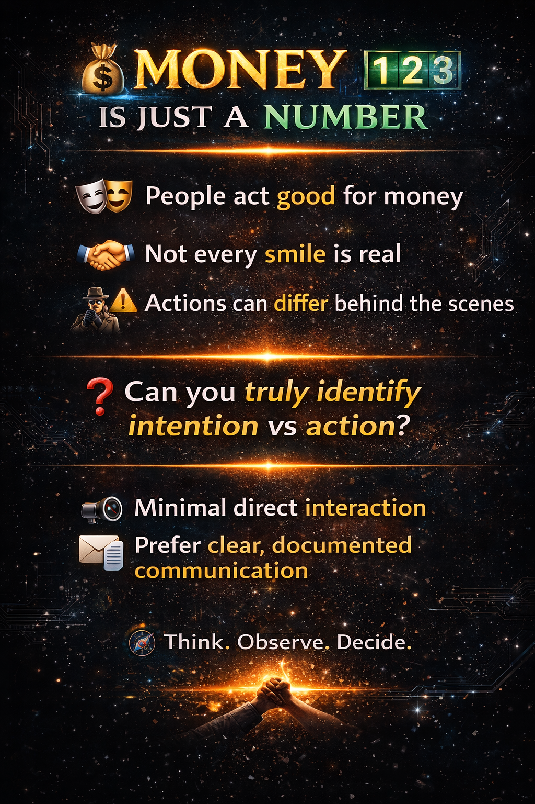

 
 

# 🏫🎓💼 Going to School, College, and the Office Is Unsafe ⚠️

> These problems have happened to me personally. People may harm or kill each other because of competition, sometimes silently separating or spreading diseases 🦠—such as emotional triggers that provoke fights 😡⚡, energy draining 🔋⬇️, creating wrong names or identities 🏷️❌, viruses 🦠, bacteria 🧫, and gambling 🎰—in a room 🚪.

> 💰 Working for money can be even more dangerous ⚠️.

> If you are a good boy or a good girl, and someone tries to make you believe that they love you, do not blindly trust them. ❤️ Sometimes, people may pretend to love or care about you as part of a plan to spoil your life. ⚠️ They may have hidden intentions, such as trying to steal your family’s wealth 💰, involve you in illegal activities such as smuggling 🚨, or become involved in serious crimes such as human trafficking or organ trafficking. 🛑

> In my case, I experienced a situation where a girl acted as though she loved me and behaved in front of others as if she genuinely loved me. This caused anger and misunderstandings among many professors, which contributed to problems in my college life and was one of the reasons my college life was affected. 😔

---

🏫 **Before 2018**, I did not receive proper guidance or deep mentorship in school, engineering college, or even at work; although I was surrounded by teachers, professors, classmates, and colleagues, I often felt intellectually alone.

🎓 My Electronics Engineering batch had around **180 students**, with **60 students in my class**, yet many struggled to enter the electronics field, and I could not find someone who could teach concepts deeply enough to build a strong understanding.

🧠 Most explanations felt like only the **first 1%—a starting connecting node**; I wanted to understand the fundamentals, deeper principles, relationships, implementation, and *why* things worked, so I had to continue the remaining journey myself.

📚 Without today's generative-AI tools, I learned independently through **YouTube, free books, research papers, online documentation, and experimentation**. My mother, **Vasugi V**, who studied B.Sc. Chemistry but had been away from formal chemistry study for about 32 years after marrying my father, **Vajravel**, was still the person who supported and taught me in many ways.

🤖 **Today, AI has become another powerful learning tool for me**—not a replacement for my own thinking, but a way to ask questions, connect concepts, explore deeply, and accelerate the self-learning journey I had already built on my own.

---

| English | Tamil |
| :---: | :---: |
|   |  |
|  |  | 
|  |  |

---

---

[💸🤑💰](https://engineer-e.github.io/Nvidia-Learning/donate/donate.html) [Pain creates the story—but choice writes the ending.
Be the one who breaks the cycle, not continues it.](https://engineer-work.github.io/Join-Company/war_prediction/human_uncertainty_pain_based_on_eduction.html) [💸🤑💰](https://engineer-e.github.io/Nvidia-Learning/donate/donate.html)

🤔💭 When people ask me questions, sometimes I’m not able to answer immediately 😅 because I don’t store every piece of information in my brain 🧠📚. I focus on multiple fields at the same time 🌍⚡, so I usually learn and understand things while actively working on them 🔍💻.

That’s why I use platforms like [GitHub](https://github.com?utm_source=chatgpt.com) and other storage tools ☁️📂 to collect, organize, and manage my work efficiently 🚀✨. Before, I mostly searched through books 📖, articles 📰, and search engines 🌐🔎 like Google 🟢🔵🟡🔴 for information. Now, I also use AI tools 🤖✨ like [ChatGPT](https://chatgpt.com?utm_source=chatgpt.com), [DeepSeek](https://www.deepseek.com?utm_source=chatgpt.com), and [Gemini](https://gemini.google.com?utm_source=chatgpt.com) to research, learn, and complete tasks faster ⚡🔥.

[💸🤑💰 **Donate**](https://engineer-e.github.io/Nvidia-Learning/donate/donate.html)
✨ *Profile* –
📅 [Planner App](https://engineer-work.github.io/planner-app/) 📌,
📊🔥 [My Learning Habit](https://docs.google.com/spreadsheets/d/e/2PACX-1vTNRg4Puo7QCFcm4ZXVF1dnX4qL6ofzOsO__GwuHJr-yke0QUXZtI51cr9Mt8Ui7QSoKTzOlr_SuB-G/pubhtml?gid=1898283119&single=true) 📈,
🆔🌐 [ORCID](https://orcid.org/0009-0001-3787-2860)
🎓📚 [Free Learning Courses to Make Simulator](https://engineer-work.github.io/Join-Company/free-learning/free-learning.html) 🚀
💻⚙️ [Desktop Computer for Scientific Computing & Simple Simulation](https://engineer-work.github.io/Join-Company/device/current_specification_device.html) 🧠
🧭🚀 [Career Path](https://engineer-work.github.io/Join-Company/startup/issue-happen-to-me-while-working-in-startup.html)
💼📈 [My Job Life](https://engineer-work.github.io/Join-Company/startup/my_career_path.html)
🎒🏫 [My College Life](https://engineer-work.github.io/Join-Company/college/pain-during-college.html)

| ⚖️ Disclaimer | 💭 My Personal Thought [Inborn Skill by Eye](https://engineer-work.github.io/Join-Company/person_identity/skill/eye/eye.html), [War, Natural Disaster, Money, Any Events Prediction](https://engineer-work.github.io/Join-Company/war_prediction/war_prediction_reason.html) | 
| :--- | ---: |   
|  , , , ,  ,  |                        |
| ⚖️📄 All content on this website represents my personal opinions and experiences only. It is intended for educational, informational, and personal documentation purposes. | 💰🔢 “Money is just a number. Who gave the rights to control the innocent species by money?” 🎭💬 For money, I have to act good to others. 🤝🙂 But we don’t know—people in front of us may act good, 🕵️‍♂️⚠️ while indirectly doing wrong. ❓🧠 Are you able to find/understand this? 🔇🚫 **So, I don’t like to talk to anyone.** 📧📄 I **prefer proper email communication to document interactions with unknown people.** |
| 🚫🎯 I do not make any claims against any specific individual, organization, government, religion, or community. Any resemblance or interpretation otherwise is purely coincidental. | 🛑⚖️ No one have the rights to control other by any material like (money, food, water, air, land, fire, marriage, education, love, etc.) |
| ⚠️🕊️ The content is not intended to incite harm, hatred, discrimination, or public disturbance. It should not be interpreted as advice or a directive to act. | 🏫🏢❓ Then, why Society? School, College, Office? giving wrong and more work, without understanding individual, but collecting lot of money. |
| 👁️‍🗨️📌 Viewers are responsible for their own interpretations and actions. I am not liable for any consequences arising from the use or misunderstanding of this content. | ⚠️🚫👼😈 Becareful, **No God and No Demon**, It **just a binary classification** like Day and Night. Many cheating innocent one, just using this binary classification algorithm. |

> **Plagiarism—copying others’ work and claiming it as one’s own—occurs globally, including in India; ethical teachings from traditions such as  ([Rishis, Siddhars](https://engineer-work.github.io/Join-Company/free-learning/not_copy/nc2.html), [Religion](https://engineer-work.github.io/Join-Company/free-learning/not_copy/nc1.html)) emphasize honesty, while modern organizations like  ([IEEE](https://engineer-work.github.io/Join-Company/free-learning/not_copy/ieee_nc.html)) and  ([Springer Nature](https://engineer-work.github.io/Join-Company/free-learning/not_copy/springer_nc.html)) strictly prohibit it and take action when detected.**

> "Which family secretly controls governments across the world? Why do the people not hold power, when a select few dominate through wealth and possess detailed data on every individual? Innocent people remain unaware of them, yet someone could validate this truth—like a person who holds the complete data of all. If the world is truly controlled by money, how can anyone genuinely trust another?"

> **The group of people, which collect PAN cards,  Aadhaar cards, Email from big MNC company or any other document from common people, have data of each individuals, they have the power to control other and direct other unknown person life, did you all know ? All the person in that group is good, or they just using unknown people like me for their family or group profit ?  If anyone said God, Demon, Love, Marriage don't believe. Which all saying only for their profit.**

---
