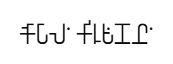

# About myself and School Life 

[💸🤑💰  donate](https://engineer-e.github.io/Nvidia-Learning/donate/donate.html) *Profile* - [My Learning Habit](https://docs.google.com/spreadsheets/d/e/2PACX-1vTNRg4Puo7QCFcm4ZXVF1dnX4qL6ofzOsO__GwuHJr-yke0QUXZtI51cr9Mt8Ui7QSoKTzOlr_SuB-G/pubhtml?gid=1898283119&single=true) , [ORCID](https://orcid.org/0009-0001-3787-2860),   [Free Learning Courses to Make Simulator](https://engineer-work.github.io/Join-Company/free-learning/free-learning.html) , [Desktop computer for Scientific Computing & Simple Simulation](https://engineer-work.github.io/Join-Company/device/current_specification_device.html), [Career Path](https://engineer-work.github.io/Join-Company/startup/issue-happen-to-me-while-working-in-startup.html), [My Job Life](https://engineer-work.github.io/Join-Company/startup/my_career_path.html) , [My College Life](https://engineer-work.github.io/Join-Company/college/pain-during-college.html)

|  |        |         | 
|---|---| --- |
| Name | Gobal Krishnan V | 😔 I’m not getting a proper job 💼❌ and not getting proper food 🍽️❌, so I look fat outside ⚖️ but I don’t eat properly; some days I eat 2 meals, sometimes 1 🍚, and some days no food at all 😢, even water needs money 💧💸.| 
| Email | gobalkrishnan.work@gmail.com, dr.bot.engineer@gmail.com | 💭 I don’t know the lifestyle of rich people 🏙️, but from my experience, many cheat others 🤥, spoil other lives 💔, and protect only their own family 🛡️👨‍👩‍👧‍👦. |
| Mobile | +91 8148729703 |💼 If I receive my full salary 💰 for the work I do from any organization—government 🏛️ or private 🏢 (school 🏫, college 🎓, office 🧑‍💻)—I can meet my needs 🛒✨; but when companies act selfishly 😐 and make layoff or firing decisions 📉🚪 without truly understanding the people behind the roles 🤷‍♂️—whether skilled or unskilled 🧠⚙️—it leads to struggle 😔💸, while they focus on stock growth 📈 and market trends or bubbles 🌊📊. |
| [ORCID](https://orcid.org/0009-0001-3787-2860) |   | 😓 I struggle to grasp knowledge from lectures 📚 and materials, and I learn slowly 🐢, but I try to achieve perfect and accurate results 🎯 by relying on high probability and statistics 📊.|
 

> Hello, My name is **Gobal Krishnan V**. [💸🤑💰](https://engineer-e.github.io/Nvidia-Learning/donate/donate.html)

> Family Members – My father's name is Vajravel, my mother's name is Vasugi V, and my younger brother's name is Kishore Kumar V. My younger brother and I do not talk to each other due to money problems in our lives.

> Since I have not been able to get a proper job, [I faced a lot of toxic culture in companies](https://www.youtube.com/watch?v=C7BEQEW_YCg). Because of that, my health was affected, so I resigned from my job. As a result, there are problems in the family due to financial issues.

> I only talk to my parents. Sometimes, in rare cases, my younger brother and I talk to each other, but only about food. Other than that, I do not even know about him.

> I do not have any boyfriends or girlfriends, and I do not like having friends. I spend most of my time with books, my phone, VR glasses (360°, 180°), and my computer for my personal activities to live my life.

> Since society is constructed based on money, everyone acts toward others mainly for survival.

> [I only like Remote Job, (Email : dr.bot.engineer@gmail.com, gobalkrishnan.work@gmail.com)  . Since, **I record all mail based on job**. since, if **working for money** is so **danger**, give me **good job to improve knowledge and good growth**.]()

> I born in 18 Jun 1995 in Chennai, Tamil Nadu, India, I done schooling from **Don Bosco Matriculation Hr. Sec. School, Erukkancherry** from 1998 (Pre.K.G) to 2012 (12th std). 

> Till 10th std, subject try to learn in school is (Tamil, English, Mathematics, Science (Physics, Chemistry, Botany, Zoology, Computer Science, Moral Science, EVS), Social Science (Geographic , History and Civics).

> For 11th and 12 std, subject to learn in school is (Tamil, English, Mathematics, Physics, Chemistry, Computer Science)

> I said about my education system during school and [college (2012 to 2016)](https://engineer-work.github.io/Join-Company/college/pain-during-college.html). is  [**Memorization-Centric Education System**](https://engineer-work.github.io/Join-Company/education_system/education_system.html) from 2020 india as changed the Education, but many state and district not changed, many school and college not know how to adapt to it , even after 6 years after change the education system (2026).
 
> [Atom man](https://engineer-work.github.io/Join-Company/atom%20man/atom_man.html) helps me from wrong people. I not seen (him/her/any object), (he/she/it) i don't know what is that, but, that person comes in light form. So, I kept the light object name as **Atom Man**

> [Learning Games](https://engineer-work.github.io/Join-Company/game%20app/game_app.html) 

> I not interested in Marriage and Love, since it all fake for money, their no true love. **I too act to others as good for money.** 

> What you learn in School, College is totally waste - if you forget [(They not training for Long term and International Standard (IEEE, Spring Nature, Arxiv,...). Since, Human brain forget lot - cheating happen only to due Forgetting in Education or Any Field)]() ? but the education system, **force to do in [Memorization-Centric Education System](https://engineer-work.github.io/Join-Company/education_system/education_system.html) for that system collecting and spending the money from our parents hardwork**. *Please, In future don't need to go to school,college.* since lot of free material in **Youtube** and **Internet**.

> Don't think why I not saying wrong about school. You itself know, how school doing, then why I said about school.

> *I not believe others, since, In india, a dowry system for marriage, for that wealthiest girls and boys parents, put lot of gold, diamond, any other objects, lot foods for marriage. for just 1 days, but different states and district in india marriage is different. for that money ? How many of life they spoiled.? Did Government have the record for it. ? Government too support to them to collect money. Include me, I too support for them for money. otherwise they kill me. this the true situation. in this timeline only, I living.*

> I join Engineering from **12th cut-off mark only in counselling in Anna University** *(during my 12th is total marks is 995/1200 marks)*, I studied Engineering in Education Loan. But, I don't know, why, I studied **Engineering** - only *Time, Health, Money wasted. We believe, that our life become great, but, if you don't have background, what you studing is totally waste.*

>  I don't know why joined Engineering, then finding for **JOB**. Many cheating for their life. If forcing me, to cheating like them for my life. *What to do? Did, I start to cheat like other or not. for my life to collect money , If the of education system is good , Sport based System is , any System is good , giving fake word?* 

> I studied in single school for 15 years, 4 years in college, **I not have friends, no love in my heart**. **I not need friends and love**, *My thought is only trigger to work for money*.  **Life is Wasted by Education System.** It only based on my life. Each have their own perspective of life. **I don't have rights to say or directs the other life**.

---

